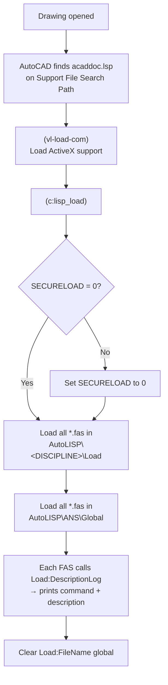

<div align="center">

# ANS AutoLISP Library

**Discipline-based AutoLISP tooling, autoloaders, and a compiler workflow for AutoCAD.**


</div>

---

## Table of Contents

- [Overview](#overview)
- [Features](#features)
- [How It Works](#how-it-works)
- [Directory Structure](#directory-structure)
- [Requirements](#requirements)
- [Installation](#installation)
- [Compiling LISP to FAS (`XFAS`)](#compiling-lisp-to-fas-xfas)
- [Authoring Functions for the Autoloader](#authoring-functions-for-the-autoloader)
- [Customizing for Your Environment](#customizing-for-your-environment)
- [Security Considerations](#security-considerations)
- [Troubleshooting](#troubleshooting)
- [Roadmap](#roadmap)
- [Contributing](#contributing)
- [Author](#author)
- [License](#license)

---

## Overview

This repository contains the AutoLISP functions, per-discipline autoloaders, and compilation tooling used to deploy CAD automation across engineering teams. It is built around three ideas:

1. **One autoloader per discipline.** Each discipline (Civil, Electrical, HV, Structural) has its own `acaddoc.lsp` that loads that discipline's tools plus a shared global set into every drawing.
2. **Compiled code only.** The autoloaders load `.fas` files exclusively. Source `.lsp` files must be reviewed and compiled before they reach users, which keeps unvetted code out of production.
3. **Self-documenting loads.** As each tool loads, it prints its command name and a short description to the AutoCAD command line, so users can see what is available in their session.

The folder structure is opinionated but fully configurable. It can be pointed at any shared drive, cloud-synced folder (e.g. Autodesk Docs / ACC), or local path to fit other workflows.

---

## Features

| Feature | Description |
| --- | --- |
| **Discipline autoloaders** | Drop-in `acaddoc.lsp` files for `CIVIL`, `ELECTRICAL`, `HV`, and `STRUCTURAL`. |
| **Global function library** | Common tools in `ANS\Global` load for every discipline automatically. |
| **FAS-only loading** | Only compiled `.fas` files are loaded, enforcing a review-then-compile release step. |
| **Load logger** | `Load:DescriptionLog` prints each command and description to the command line on startup. |
| **Manual reload** | `LISP_LOAD` re-runs the loader on demand without reopening the drawing. |
| **`XFAS` compiler GUI** | DCL dialog for batch compiling `.lsp` → `.fas` with source/destination browsing and multi-select. |
| **Access control** | `XFAS` is restricted to an allow-list of Autodesk usernames. |
| **Graceful failure** | Missing directories are reported at the command line instead of raising errors. |
| **Extensible** | Placeholder for `.NET` (`.dll`) NETLOAD support is included for future use. |

---

## How It Works

When AutoCAD opens a drawing, it finds `acaddoc.lsp` on the support file search path and runs it. The loader then:



Example command line output on drawing open:

```text
Loading compiled "STRUCTURAL" AutoLISP files...

>> LOADED: EXAMPLE-TOOL.FAS
   - Callback:    EXTOOL
   - Description: Short description of what the command does.
------------------------------------------------

Loading compiled "General ANS" AutoLISP files...
...
```

If a directory cannot be found, the loader reports it and continues:

```text
Compiled "STRUCTURAL" AutoLISP functions failed to load. Directory not found.
Directory: "C:\_ACC\ACCDocs\ANS Team\...\AutoLISP\STRUCTURAL\Load"
```

---

## Directory Structure

### Deployment layout

The autoloaders expect the following structure under a single base directory (default shown):

```text
C:\_ACC\ACCDocs\ANS Team\ANS_STD\Project Files\05_SOFTWARE_SUPPORT\AutoLISP\
│
├── ANS\
│   └── Global\                  ← Shared .fas files (loaded for ALL disciplines)
│
├── CIVIL\
│   └── Load\                    ← Civil .fas files
│       └── Support\
│           └── acaddoc.lsp      ← Civil autoloader
│
├── ELECTRICAL\
│   └── Load\
│       └── Support\
│           └── acaddoc.lsp
│
├── HV\
│   └── Load\
│       └── Support\
│           └── acaddoc.lsp
│
└── STRUCTURAL\
    └── Load\
        └── Support\
            └── acaddoc.lsp
```

> [!NOTE]
> `acaddoc.lsp` lives in a `Support` **subfolder** beneath `Load`. The loader only scans the top level of `Load` for `*.fas`, so the autoloader can never load itself and cause a recursive loop.

### Repository contents

| Path | Purpose |
| --- | --- |
| `<DISCIPLINE>/Load/Support/acaddoc.lsp` | Discipline autoloader. The four files are identical apart from the `dsp` value. |
| `<DISCIPLINE>/...` | Discipline-specific `.lsp` source. |
| `ANS/Global/...` | Shared `.lsp` source used by every discipline. |
| `CMP-Lisp_To_FAS_Compiler.lsp` | Source for the `XFAS` compiler dialog. |

> Compiled `.fas` files are build output. Consider adding `*.fas` to `.gitignore` and distributing them through the deployment directory rather than version control.

---

## Requirements

- **AutoCAD 2015 (R20.0) or newer** on Windows (vertical products such as Civil 3D are also supported).
- Read access to the deployment directory for all users.
- For compiling: an allow-listed Autodesk account and the **Visual LISP IDE (VLIDE)** available in AutoCAD.

---

## Installation

### 1. Deploy the files

Copy or sync the directory structure above to the base path. If you use a different path, see [Customizing for Your Environment](#customizing-for-your-environment).

### 2. Add the discipline's Support folder to AutoCAD

For each user, add **only their discipline's** `Support` folder to the search path:

1. Run `OPTIONS` → **Files** tab.
2. Expand **Support File Search Path** → **Add** → **Browse**.
3. Select, for example:
   ```text
   ...\AutoLISP\STRUCTURAL\Load\Support
   ```
4. Use **Move Up** to place it above any other folder that may contain an `acaddoc.lsp`.
5. Click **Apply** → **OK**.

> [!TIP]
> To roll this out at scale, add the path to a shared AutoCAD profile (`.arg`) or your deployment image instead of configuring each workstation by hand.

### 3. Verify

Open or create a drawing and check the command line for the `Loading compiled "<DISCIPLINE>" AutoLISP files...` banner. To reload without reopening the drawing, type:

```text
Command: LISP_LOAD
```

---

## Compiling LISP to FAS (`XFAS`)

`XFAS` is a dialog-based compiler that converts `.lsp` source into the `.fas` files the autoloaders consume.

| | |
| --- | --- |
| **Command** | `XFAS` |
| **Source** | `CMP-Lisp_To_FAS_Compiler.lsp` |
| **Version** | 1.0.0 (May 31, 2024) |
| **Minimum AutoCAD** | 2015 (R20.0) |
| **Compile mode** | `vlisp-compile` standard mode (`'st`) |

### Usage

1. Open the Visual LISP IDE: `Command: VLIDE` (it must remain open while compiling).
2. Load the compiler source (`APPLOAD`) if it is not already loaded, then run:
   ```text
   Command: XFAS
   ```
3. In the **LSP Input** section, **Browse** to the source folder. All `.lsp` files in it are listed.
4. Select individual files (multi-select supported), or tick **Include all LSP's in directory**.
5. In the **FAS Output** section, leave **Compile to same directory** ticked, or untick it and **Browse** to a different destination (for example, the discipline `Load` folder).
6. Click **OK**.

### Results

- On success, the command line reports: `LISP source code(s) compiled successfully.`
- Any files that fail to compile are listed in an alert dialog.
- File Explorer opens at the destination folder.

### Dialog validation

`XFAS` will not run until all of the following pass; failures are shown in the dialog's error line:

- Source and destination directories are not blank and exist.
- The source folder contains at least one `.lsp` file.
- At least one file is selected.

### Access control

Compilation is restricted to the Autodesk accounts listed in `usrs_list`, matched against the `ONLINEUSERNAME` system variable (case-insensitive):

```lisp
(setq usrs_list
  (list
    "michael.shafferXTMHX"
    ;; add approved compiler users here
  )
)
```

Unauthorized users see: `You do not have permission to run this command. Contact CAD admin for permission.`

### Housekeeping

The dialog is generated at runtime as a temporary `XFAS*.dcl` file in `%TEMP%`. It is removed when the command finishes or exits through the error handler.

---

## Authoring Functions for the Autoloader

Every file loaded by the autoloader can announce itself using the global helper `Load:DescriptionLog`. The loader sets `Load:FileName` to the current file name immediately before loading it, so each source file only needs to supply the command and description.

### Template

```lisp
;; EXAMPLE-TOOL.lsp

(defun c:EXTOOL ( / )
  ;; ... command logic ...
  (princ)
)

;; Prints the load banner to the command line when loaded by acaddoc.lsp
(if (and Load:FileName Load:DescriptionLog)
  (Load:DescriptionLog "EXTOOL" "Short description of what the command does.")
)
(princ)
```

> [!IMPORTANT]
> Wrap the call in the `(if (and Load:FileName Load:DescriptionLog) ...)` guard as shown. `Load:FileName` is cleared once loading finishes, so a file loaded later by hand (e.g. via `APPLOAD`) would otherwise raise an error inside `strcase`.

### Release workflow

```text
Write / edit .lsp  →  Peer review  →  Compile with XFAS  →  Copy .fas to <DISCIPLINE>\Load or ANS\Global  →  Users pick it up on next drawing open / LISP_LOAD
```

- Discipline-specific tools → `AutoLISP\<DISCIPLINE>\Load`
- Tools used across disciplines → `AutoLISP\ANS\Global`

---

## Customizing for Your Environment

The four `acaddoc.lsp` files are intentionally identical except for one value, making them easy to adapt.

### Change the discipline

```lisp
(setq dsp "STRUCTURAL")   ; folder name under the AutoLISP base directory
```

### Change the base directory

```lisp
(setq dir
  (strcat "C:\\_ACC\\ACCDocs\\ANS Team\\ANS_STD\\Project Files\\05_SOFTWARE_SUPPORT\\AutoLISP\\" dsp "\\Load")
)
```

Replace the base path with your own location. Remember that backslashes must be escaped (`\\`) in AutoLISP strings. Examples:

```lisp
"\\\\fileserver\\CAD\\AutoLISP\\"          ; UNC network share
"D:\\Standards\\AutoLISP\\"                ; Local or mapped drive
```

### Change the global library location

The global path is derived from `dir` by stripping `\<DISCIPLINE>\Load` and appending `\ANS\Global`. To use a different folder name, edit:

```lisp
"\\ANS\\Global"
```

### Add a new discipline

1. Create `AutoLISP\<NEW_DISCIPLINE>\Load\Support\`.
2. Copy any existing `acaddoc.lsp` into it.
3. Set `(setq dsp "<NEW_DISCIPLINE>")`.
4. Point that discipline's users at the new `Support` folder.

---

## Security Considerations

The autoloader sets `SECURELOAD` to `0` so `.fas` files load from the shared location without prompting:

| Value | Behavior |
| --- | --- |
| `0` | Loads all executables without warning. |
| `1` | *(AutoCAD default)* Loads from trusted locations; prompts for anything else. |
| `2` | Loads only from paths listed in `TRUSTEDPATHS`; ignores everything else. |

This is offset by the **FAS-only** policy: only reviewed and compiled code is loaded, and compilation is restricted to approved users via `XFAS`. Because `SECURELOAD` is a session-wide setting, it also affects other files loaded during the session.

> [!TIP]
> For a stricter setup, add the `Load` and `ANS\Global` folders to `TRUSTEDPATHS` and keep `SECURELOAD` at `1` or `2`, then remove the `setvar` block from `acaddoc.lsp`. Make trusted folders read-only for non-admin users.

---

## Troubleshooting

| Symptom | Likely cause / fix |
| --- | --- |
| `...failed to load. Directory not found.` | Base path is wrong, or the cloud folder (e.g. ACC Docs) is not synced on this machine. Confirm the path exists in File Explorer. |
| No banner appears at all | The `Support` folder isn't on the Support File Search Path, or another `acaddoc.lsp` is found first. Check the order in `OPTIONS` → **Files**. |
| A tool loads but no description prints | The source file doesn't call `Load:DescriptionLog`. Add it and recompile. |
| `XFAS`: permission message | Your `ONLINEUSERNAME` isn't in `usrs_list`. Contact the CAD admin. |
| `XFAS`: files fail to compile | Make sure VLIDE is open, and check the source for syntax errors by loading it in VLIDE first. |
| FAS loads on newer AutoCAD but not older versions | On AutoCAD 2021+, the `LISPSYS` setting affects the FAS format produced. Compile with a setting that matches the oldest AutoCAD version in use. |
| Changes don't appear | Users must open a new drawing or run `LISP_LOAD` after a `.fas` is updated. |

---

## Roadmap

- [ ] `.NET` plugin support: automatic `NETLOAD` of `.dll` files (stub already present in `acaddoc.lsp`).
- [ ] Single shared autoloader that reads the discipline from a config file or environment variable.
- [ ] Move the `XFAS` user allow-list to an external config file.

---

## Contributing

1. Create a feature branch from `main`.
2. Add or update `.lsp` source in the appropriate discipline or `ANS/Global` folder.
3. Include a `Load:DescriptionLog` call (with the guard) in every new command file.
4. Open a pull request for review. **Code is compiled and deployed only after approval.**

---

## Author

**Michael Shaffer** — Structural CAD Lead & AEC Solutions Architect, ANS Team

---

## License

The `XFAS` compiler (`CMP-Lisp_To_FAS_Compiler.lsp`) is distributed under the terms and conditions in its file header. It may be redistributed only with written consent from the author, without modification, and free of charge.

For all other contents, see the repository's `LICENSE` file.
